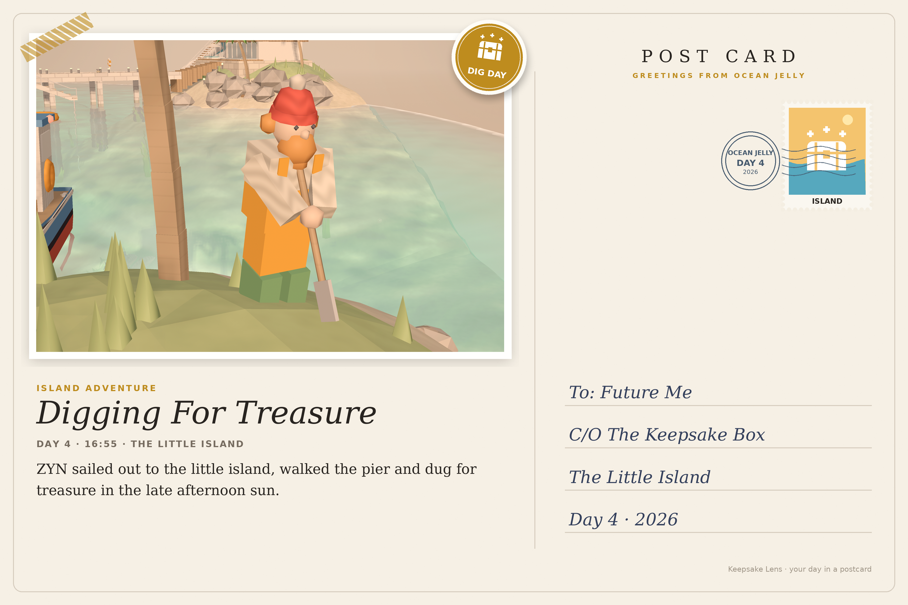
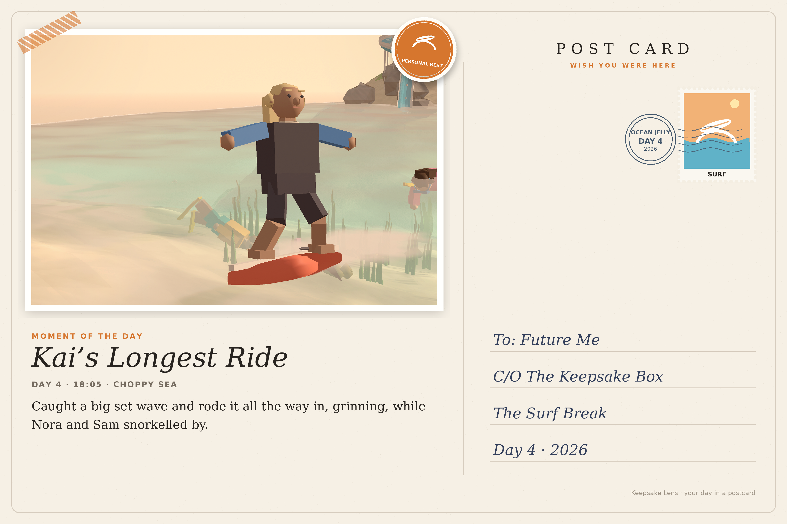
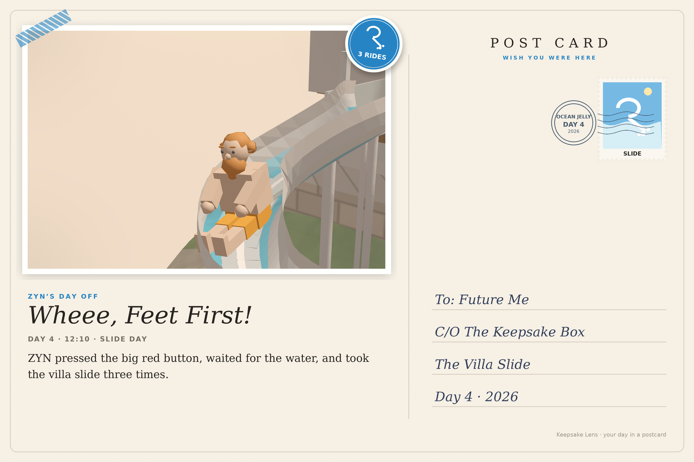
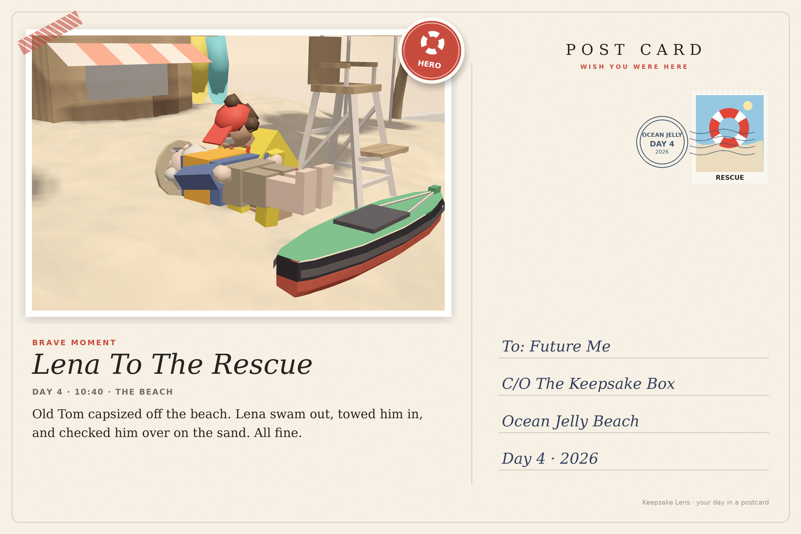
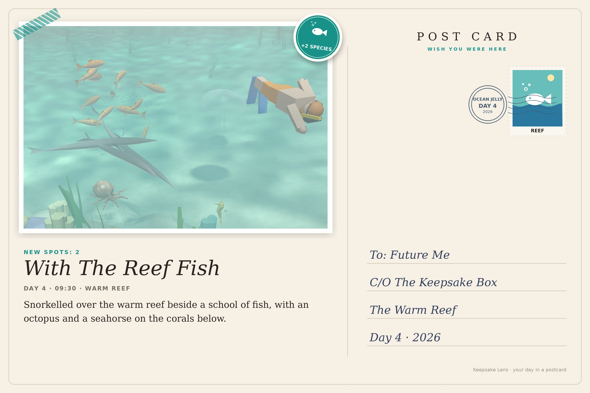

# Keepsake Lens

**An agent skill that turns the best moment of a session in your 3D world into a postcard you'd actually keep.**

Most "auto screenshots" catch a random frame from behind the character. Keepsake Lens works like a little photographer living in your world:

1. **Logs real moments** from your game's own logic — a rescue, a record ride, a rare find — never invented ones.
2. **Picks the day's keepsake** — rarity, firsts, how many characters were there, lovely light, and variety across days.
3. **Frames faces, not backs** — it reads each character's orientation and puts the camera in front, in a three-quarter view, centres groups and fits everyone in, keeps bystanders out of frame, rejects shots the renderer can't make (outside the world, underwater, behind walls), and comes in closer near edges.
4. **Captures cleanly** — UI hidden, canvas only; headless WebGPU capture for previews and docs.
5. **Composes a postcard** — laid out like a real one: the photo and message on the left, a divider, and a "POST CARD" heading, stamp, postmark and address lines on the right. Every card gets something of its own — a stamp illustration, a corner sticker with a badge ("Personal Best", "Hero"), and an accent colour — and can be made at 4K (3840×2560). The caption is written only from logged facts.



*Example card from the Ocean Jelly diorama: Lena the lifeguard checking on Old Tom after a real in-game rescue. The camera was placed by `KeepsakeLens.faceOnCamera` from Lena's orientation, framing her and Old Tom together. For this documentation sample the beach was staged quiet (the sunbathers who lie beside the rescue spot were sent home before the capture).*

## Gallery

Four keepsakes from one day in the Ocean Jelly diorama, at 4K (3840×2560). Each photo is a real capture from the running world, framed by the skill; each card has its own stamp, sticker and colour.

| | |
|---|---|
|  |  |
|  |  |

Works with Three.js, Babylon.js, PlayCanvas, raw WebGPU/WebGL or any canvas world. It follows the open Agent Skills format (a folder with a `SKILL.md`), so it can be used by Claude Code, Claude.ai and other agents that read skills.

## Install

**Any agent (Claude Code, Codex, Cursor and more) with the skills CLI:**

```bash
npx skills add Jennni0/keepsake-lens
```

**Claude Code plugin marketplace:**

```
/plugin marketplace add Jennni0/keepsake-lens
/plugin install keepsake-lens@keepsake-lens
```

**By hand:** copy `skills/keepsake-lens` into `~/.claude/skills/` (personal) or `.claude/skills/` in a project.

**Claude.ai:** download `keepsake-lens.skill` from the Releases page and add it in your skills settings.

Then just ask, e.g. *"Add a postcard of the best moment at the end of each day"* or *"My photo mode keeps catching characters from behind — fix it."*

## What's inside

| Path | What it is |
|---|---|
| `skills/keepsake-lens/SKILL.md` | The workflow the agent follows: log → pick → frame → capture → compose → review |
| `skills/keepsake-lens/scripts/keepsake.js` | Dependency-free library: moment log and scoring, keepsake picker, `faceOnCamera`, `facesCamera`, fact-only captions |
| `skills/keepsake-lens/scripts/capture.mjs` | Playwright capture with WebGPU in headless Chromium (SwiftShader), staging script, UI hiding, error reporting |
| `skills/keepsake-lens/scripts/compose_postcard.py` | Pillow postcard composer driven by a small JSON spec |
| `skills/keepsake-lens/scripts/contact_sheet.py` | Review sheet that flags blank and backdrop-only shots |
| `skills/keepsake-lens/references/` | Moment scoring, framing rules, engine notes and headless pitfalls, postcard style |
| `skills/keepsake-lens/assets/` | Example spec, caption templates, example staging script, example card |
| `skills/keepsake-lens/evals/` | Test cases in the `claude plugin eval` layout |
| `.claude-plugin/` | Claude Code plugin and marketplace manifests |
| `examples/` | The four example postcards shown above |

## Quick taste

```js
const lens = KeepsakeLens.create();
// in your game logic
lens.record({ type: 'rescue', t: worldTime, subjects: ['lena', 'tom'], at: tom.position,
              rarity: 0.4, intensity: 0.8, facts: { rescuer: 'Lena', swimmer: 'Old Tom', place: 'the beach' } });

// at dusk
const pick = lens.pickBest({ since: dayStart });
const lena = world.get('lena');
const shot = KeepsakeLens.faceOnCamera({ p: lena.position, q: lena.quaternion },
  { distance: 0.25, pitch: 0.12, isValid: pos => world.inside(pos) });
camera.position.set(...shot.position); camera.lookAt(...shot.target);
```

```bash
node skills/keepsake-lens/scripts/capture.mjs --root ./my-game --stage stage.js --query offscreen --out shot.png
python3 skills/keepsake-lens/scripts/compose_postcard.py spec.json
python3 skills/keepsake-lens/scripts/contact_sheet.py out/*.png -o sheet.png
```

Requirements: Node 18+ and Playwright (for `capture.mjs`), Python 3 with Pillow (for the postcard and sheet scripts). `keepsake.js` has no dependencies.

## Principles

- **Honest keepsakes.** Only moments that happened, captions only from logged facts. Example cards made before the feature exists are labelled as mock-ups.
- **Faces first.** A keepsake of someone's back isn't a keepsake.
- **The player decides.** Nothing is posted anywhere automatically.

## License

MIT — see `LICENSE`.
